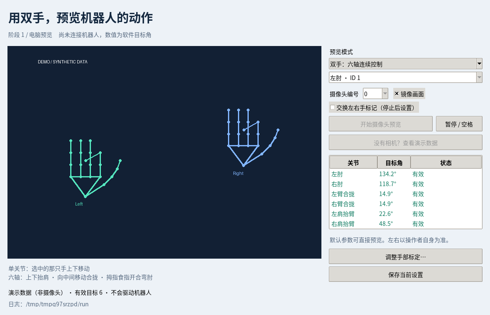

# AIC 手势控制

当前新增了 **[左手底盘控制独立电脑端](projects/left_hand_chassis/README.md)**：握拳前进、五指展开后退、每次校准静止手势和掌面倾角零点，像转方向盘一样左右倾斜转向。

**使用新版本：**进入 `projects/left_hand_chassis`，双击 `run_pc.cmd`；也可在仓库根目录双击 `run_chassis.cmd`。代码、接口说明、开发日志和验证记录均在子项目内。当前阶段为电脑预览，真人手势效果待现场确认，机器人尚未接入。

此前的上肢预览代码保留，以下为其原使用说明。

## AIC 手势控制 · 电脑端预览 v0.1.1

打开电脑摄像头，显示双手关键点，并将手部运动转换为机器人六个上肢关节的软件目标角。第一阶段已实现电脑预览、可选标定和运行日志；机器人通信将在下一阶段接入。



## 在 Windows 上开始

1. 更新此仓库；首次使用可以执行：

   ```powershell
   git clone https://github.com/luxinruui/aic--.git
   cd aic--
   ```

   已有本地副本时，在那个目录执行 `git pull --ff-only`。需要同步运行日志时请使用 Git 克隆的副本；ZIP 下载的副本也可运行程序，但没有 Git 历史。

2. 双击 **`run_preview.cmd`**。它会依次显示寻找 Python、检查环境、安装依赖、打开预览四步。首次需要联网安装依赖；之后不会重复安装已经匹配的依赖。安装完成后会自动打开预览，无需再启动另一个文件。
3. 默认是“单关节：掌心上下控制 / 左肘”。点击 **开始摄像头预览**，把自己的左手完整放入画面，上下移动，观察左肘目标角变化。
4. 按空格或点击暂停。要看完整效果，切换“双手：六轴连续控制”，再开始预览。

需要 **64 位 Python 3.10、3.11 或 3.12**；优先使用电脑已有的 Python 3.10。环境安装在项目内，不修改原来的 `robot_vision` 环境。不支持用 Python 3.13+ 安装当前固定版本的 MediaPipe。

只想先看界面，可以双击 `run_demo.cmd`，或点击“查看演示数据”。演示中偶尔主动隐藏左手，用于展示失效目标清空；这不是摄像头识别结果。

**如果之前按任意键后关窗、一直没有预览：**下载新版到另一个文件夹，双击 **`diagnose_preview.cmd`**。这个入口的黑色窗口会一直保留。失败后查看或发送 `logs/startup/latest.log`；若还没进入 Python，则查看 `logs/startup/launcher.log`。也可以在项目文件夹地址栏输入 `cmd` 并回车，再输入 `run_preview.cmd` 运行，原来的命令窗口不会自动关闭。

`setup_preview.cmd` 是单独安装/修复环境的入口，成功后提示另行打开 `run_preview.cmd`；要直接打开预览，使用 `run_preview.cmd` 或 `diagnose_preview.cmd`。

## 如何控制预览目标

单关节模式可以选择左/右肘、左右臂合拢、左右肩抬臂中的一个，用对应手掌的上下位置控制。其余关节显示无目标。

双手六轴模式中，每只手独立控制同侧机器人手臂：

| 手部操作 | 机器人软件目标 | 左 / 右舵机 ID |
| --- | --- | --- |
| 掌心上下移动 | 肩抬臂，0～90° | 4 / 34 |
| 掌心向身体中间 / 外侧移动 | 大臂合拢 / 展开，0～90° | 3 / 33 |
| 拇指食指捏合 / 张开 | 肘弯曲 / 伸直，0～180° | 1 / 31 |

左右以操作者自身为准。镜像选项只改变显示，不改变目标映射。如果摄像头驱动本身镜像了输入，先暂停，勾选“交换左右手标记”，再开始确认。

角度采用原六轴接口的定义，未转换成实际舵机位置。本程序没有串口、机器人网络发送或硬件使能，不会驱动机器人。

## 可选标定

默认参数可以直接观察数值变化。若操作范围不合适，保持真实摄像头预览，点击“调整手部标定…”：

1. 选择左手或右手，把手移到舒适的上/下位置，分别记录上下边界。
2. 双手六轴模式还可记录外侧、内侧位置，以及拇指食指捏合和张开状态。
3. 点击保存设置，写入 `config/preview.json`。

每个端点需与另一个端点保持足够距离；无效标定会提示原因。合成演示数据不能用于真人标定。手指开合使用指尖距离与掌宽之比，距离计算考虑画面宽高比例。

## 代码和日志同步

运行结束后双击 **`sync_github.cmd`**，提交并推送新运行日志及标定设置到当前 Git 分支。首次推送可能需要在 Git 的正常登录流程中登录 GitHub；程序不保存 GitHub 密钥。

- `logs/runs/<运行编号>/run.json`：版本、输入来源、配置、处理帧数及结束原因。
- `frames.csv`：约每秒 10 行的手部位置、开合比例、目标角与有效性，可用 Excel 打开。
- `events.jsonl`：开始、模式切换、标定、异常、超时和结束事件。
- `logs/development/`：开发进度和验证说明。
- `logs/verification/`：已执行的软件检查记录。
- `logs/startup/latest.log`：最新一次启动的进度、安装及程序输出；`previous.log` 保留上一次记录，`launcher.log` 记录 Python 启动前的错误。

运行日志默认只保存数值和事件，不保存摄像头图片或视频。同步脚本只处理运行日志、启动日志和 `config/preview.json`，不会把其他代码改动、图片或整个工作目录一起提交；有其他已暂存改动时会停止并提示。远端更新导致推送失败时，日志仍保存在本地，先处理 Git 更新后再同步；不会强制推送。

## 常见问题

- **摄像头打不开**：退出旧姿态程序、会议软件或其他相机应用；检查 Windows“设置 → 隐私和安全性 → 摄像头”中桌面应用权限；暂停后将摄像头编号从 0 改成 1、2 再试。
- **一直没有有效目标**：默认模式只接受左手；保持整只手入镜、光线充足，避免双手交叉遮挡。左右手分类不确定、手太小或关键点出界时，目标显示为空。
- **停留在旧画面或卡顿**：超过 350ms 的旧采样不能生成有效目标；窗口超时会清空当前画面和目标。
- **依赖或版本错误**：重新双击 `setup_preview.cmd`。务必运行项目自己的启动脚本，不要直接在原环境里安装覆盖依赖。
- **默认 Python 版本太新或旧环境没装完整**：新版会寻找电脑上已有的受支持版本，检查并修复项目依赖；不兼容的旧 `.venv` 会保留，另建独立环境。找不到受支持版本时会明确报错并写日志。
- **Windows 安装时报 DLL 缺失**：确认使用 64 位 Python，并按错误提示检查 Microsoft Visual C++ 运行库；保留错误文本用于排查。

## 命令行与验证

```sh
# Linux / macOS 也可使用安装脚本；当前已核对 Linux x86_64 与 Windows x64 依赖。
python3 scripts/setup_preview.py
.venv/bin/python -m aic_hand

# 检查依赖、内置模型哈希，并在空白图片上做一次真实模型推理
python -m aic_hand --check

# 使用合成手部，生成一次六轴预览日志（不打开摄像头或窗口）
python -m aic_hand --headless --demo --mode six --frames 180

# 在真实电脑上检查摄像头，可自选编号
python -m aic_hand --camera 0

python -m unittest discover -s tests -v
python scripts/gui_smoke.py
```

Windows 命令行中的 `python` 应替换成 `.venv\Scripts\python.exe`；Linux 使用 `.venv/bin/python`。Linux GUI 需要 Tk 和图形会话；无桌面验证可用 `xvfb-run -a` 运行 GUI 检查。

第一版采用 **MediaPipe 0.10.21 自带的 `solutions.hands` 完整模型**，避免首次运行再单独下载模型。它与设计阶段提到的 Tasks Hand Landmarker 使用不同 API，后续迁移需单独适配。依赖版本固定，识别在本地 CPU 执行。

当前已完成软件映射、日志、真实模型空白图推理及合成数据 GUI 检查。云端环境没有用户电脑的摄像头，真人识别精度、左右手实际对应及帧率仍需在电脑上验收；机器人尚未接入。

## 文件结构与下一步

- `aic_hand/capture.py`：摄像头与识别线程，或合成演示源。
- `aic_hand/core.py`：六轴映射、有效性、新鲜度、平滑与死区。
- `aic_hand/gui.py`：摄像头预览、模式切换和标定。
- `aic_hand/runlog.py`：运行日志。
- `scripts/`：安装、日志同步及 GUI 检查。
- `tests/`：映射、采样生命周期及真实本地 Git 同步检查。

下一步按 [完整方案](docs/手势控制实现方案.md) 接入原 `backpack_arms6` 执行链路，复用现有标定、限位和通信。电脑端预览本身不需要 MLKPAI-FS01 新板卡。
